# 🫀 Smoking Health Risk Analysis Dashboard


## 📌 Project Overview

The **Smoking Health Risk Analysis Dashboard** is an interactive Power BI project designed to explore the relationship between smoking habits, patient demographics, and selected health risk indicators.

The dashboard helps users examine patient information across different age groups and genders, understand smoking patterns, and explore indicators such as cholesterol level and blood-pressure risk. Interactive filters allow users to focus the analysis on selected organs and health conditions.

## 🎯 Project Objectives

- Analyze smoking status across patient groups.
- Explore smoking behaviour across different age groups and genders.
- Examine years of smoking and cigarettes smoked per day.
- Understand how cholesterol levels and blood-pressure risk vary across age groups.
- Present key patient metrics in an interactive dashboard.
- Support data-driven exploration of potential health-risk patterns.

## 🛠️ Tools & Technologies

- **Microsoft Power BI** – Dashboard development and data visualization
- **Power Query** – Data preparation and transformation (where applied)
- **DAX** – Measures and calculations used in the report
- **Data Modeling** – Relationships between the report's health, condition, organ, and image-related tables

## 📊 Dashboard Features

### 1. Key Performance Indicators (KPIs)
- Total patient count
- Average age comparison indicator
- Average BMI comparison indicator

### 2. Smoking Status Analysis
- Distribution of patients by smoking status
- Percentage contribution of each smoking-status category

### 3. Smoking Behaviour by Age Group
- Years of smoking across age groups
- Cigarettes smoked per day across age groups

### 4. Gender-Based Analysis
- Comparison of smoking-status categories by gender
- Patient distribution across smoking groups

### 5. Health Risk Indicators
- Cholesterol-level analysis across age groups
- Blood-pressure risk comparison across age groups

### 6. Interactive Filters
- Organ selection
- Organ-condition selection

These filters allow users to explore the report from different perspectives.

## 🔍 Key Analytical Questions

This dashboard is designed to help investigate questions such as:

1. How are patients distributed across smoking-status categories?
2. How does smoking behaviour vary by age group?
3. How do years of smoking and cigarettes per day differ across age groups?
4. Are smoking-status patterns different between genders?
5. How do cholesterol levels vary across age groups?
6. How is blood-pressure risk distributed across age groups?

## 💡 Business & Analytical Value

The dashboard provides a consolidated view of patient and smoking-related indicators. It can help analysts and healthcare stakeholders:

- Identify patterns in smoking behaviour.
- Compare patient groups using demographic categories.
- Explore relationships between smoking-related variables and selected health indicators.
- Communicate findings through clear, interactive visualizations.
- Identify areas that may deserve further investigation.

**Important:** This dashboard is intended for exploratory and educational analysis. Visual associations do not establish causation, diagnose medical conditions, or replace professional medical advice.

## 🖥️ Dashboard Preview

Add a screenshot of your Power BI dashboard to this repository and update the image path below:

```markdown

```

## 📁 Repository Structure

```text
Smoking-Health-Risk-Analysis/
│
├── README.md
├── Health risk anlayst.pbix
└── images/
    └── dashboard-preview.png
```

*The `images/dashboard-preview.png` file is an optional screenshot that you can add to display the dashboard on GitHub.*

## 🚀 How to Use

1. Clone or download this repository.
2. Open `Health risk anlayst.pbix` using Microsoft Power BI Desktop.
3. If Power BI requests access to the original data source, configure the required source connection.
4. Explore the dashboard using the available organ and condition filters.
5. Select different categories to interact with the visualizations.

## 📚 Skills Demonstrated

- Data Analysis
- Data Visualization
- Exploratory Data Analysis (EDA)
- Power BI Dashboard Development
- KPI Reporting
- Demographic Analysis
- Comparative Analysis
- Analytical Storytelling

## 👨‍💻 Author

**Mohammad Zidan**

Aspiring Data Analyst | Power BI | SQL | Python | Excel

- **GitHub:** [Zidhann7](https://github.com/Zidhann7)
- **Portfolio:** [Data Analyst Portfolio](https://zidhann7.github.io/data-analyst-portfolio/)

---

⭐ If you find this project interesting, feel free to explore the repository and share your feedback.
